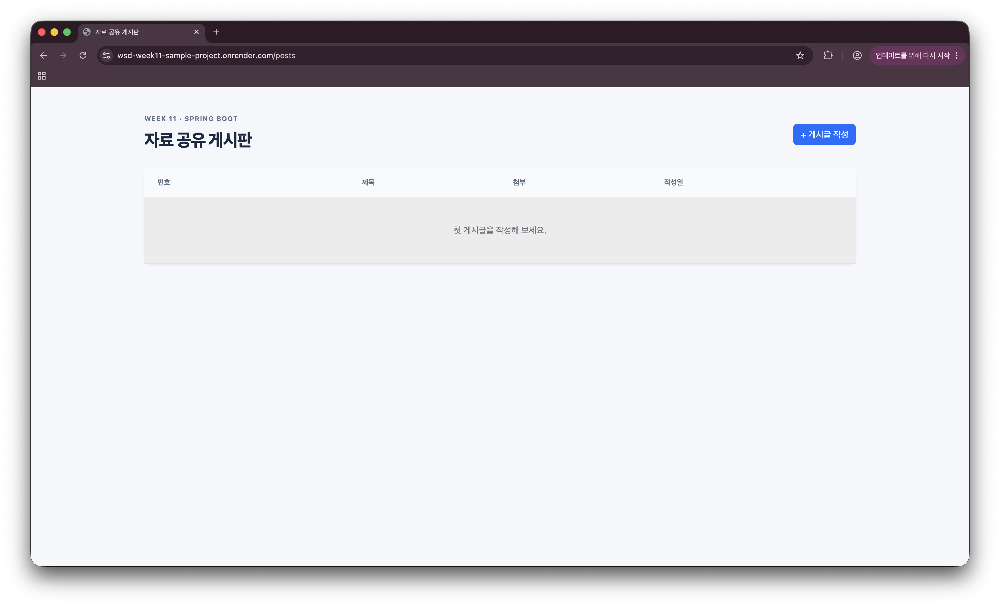
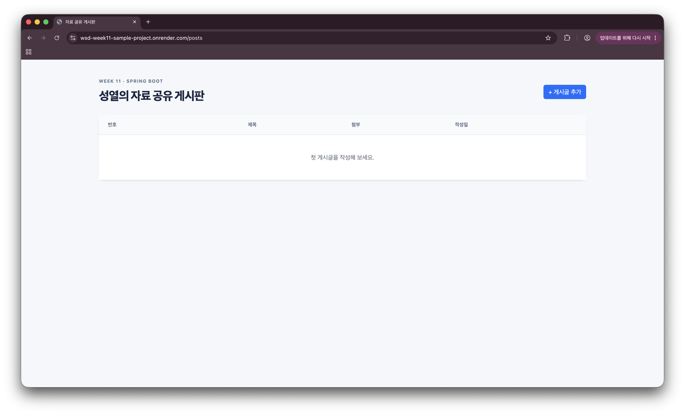
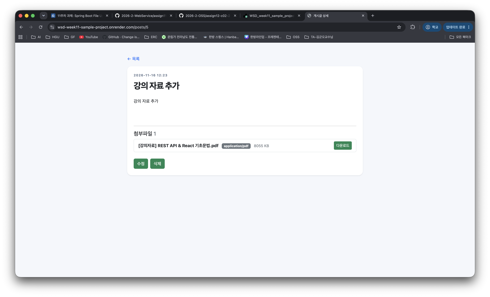
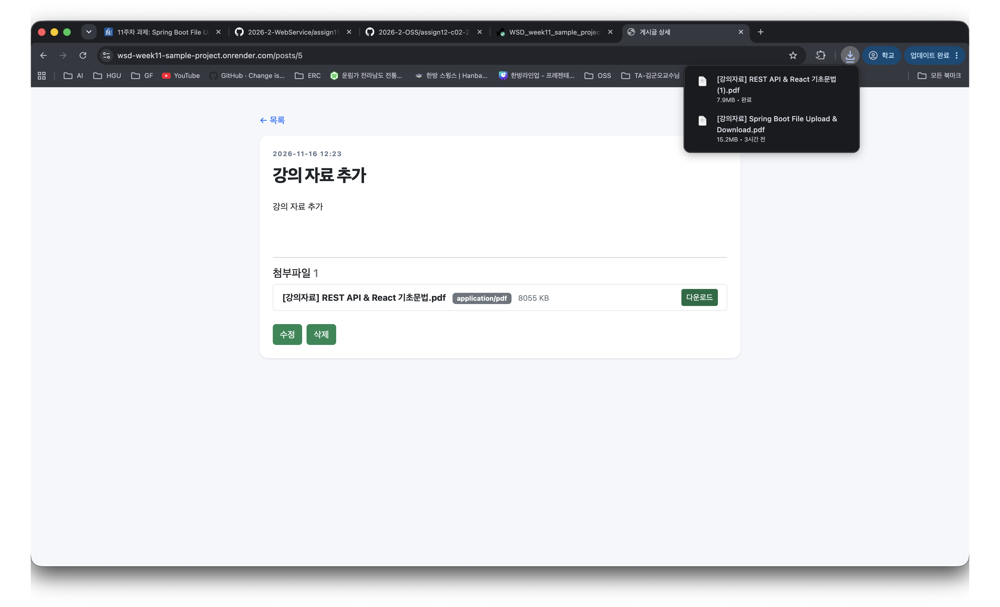
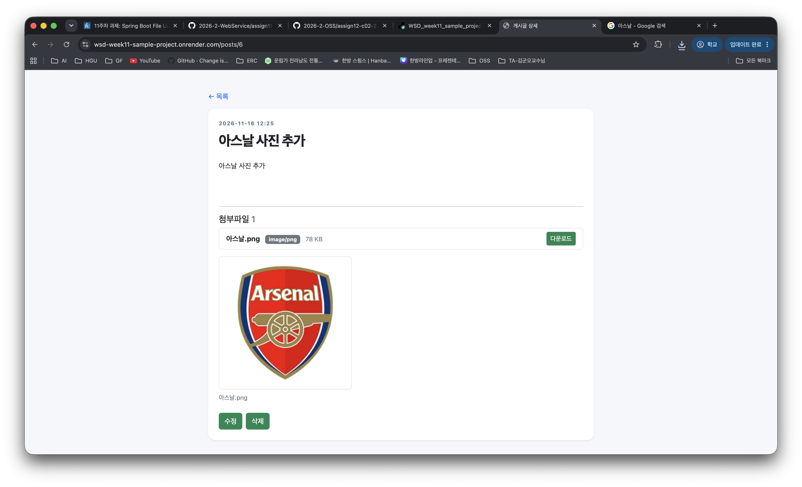

## Week 11 — Attachment Board 22200619 임성열

## Project Information
### 프로젝트 소개
- Spring Boot, Thymeleaf, JPA, MariaDB를 활용하여 게시글 CRUD와 파일 업로드/다운로드, 이미지 미리보기 기능을 구현한 자료 공유 게시판
### GitHub Repository URL
- https://github.com/2026-2-WebService/assign11-c01-22200619.git
### Render Deployment URL
- https://wsd-week11-sample-project.onrender.com/posts

## Installation: 환경 설정 및 실행 방법
1. 환경 변수를 통해서 DB_URL, DB_USERNAME, DB_PASSWORD를 등록해서 MariaDB 계정 정보를 설정
2. 이를 바탕으로 main에서 실행. 

## Source Code Exploration
### Project Structure & Spring MVC
### 1. PostController, PostService, PostRepository는 각각 어떤 역할을 하며, 서로 어떻게 연결되는가?
- PostController는 사용자가 게시글을 작성하거나 조회할 때 보내는 요청을 받고 적절한 처리 결과 화면으로 연결한다. 
- PostService는 게시글 생성, 수정, 삭제와 같은 실제 작업을 처리하고 PostRepository는 JPA를 이용해 DB에 게시글을 저장하거나 조회한다. 
- 예를 들어 계시판 작성 요청이 들어오는 경우 PostController.create()에서 PostService.create()로 전달되고, 마지막에 Repository의 saveAndFlush()를 통해 DB에 저장되는 방식으로 서로 작동한다.
- 관련 소스파일: `PostController.java`, `PostService.java`, `PostRepository.java`
- 관련 메서드: `PostController.create()`, `PostService.create()`, `PostRepository`가 상속받은 `saveAndFlush()`

### 2. 게시글 작성 시 HTML Form의 입력값과 첨부파일은 Controller에 어떻게 전달되는가?
- 작성 화면의 Form은 POST 방식과 enctype="multipart/form-data"를 사용하여 글 내용과 파일을 함께 전송한다. 
- 제목과 내용은 @ModelAttribute를 통해 PostForm 객체에 담기고, 첨부파일은 @RequestParam(name = "files")를 통해 List<MultipartFile>로 전달된다. 
- 관련 소스파일: `templates/posts/form.html`, `PostForm.java`, `PostController.java`
- 관련 메서드: `PostController.create()`
- 관련 코드: `enctype="multipart/form-data"`, `name="files"`, `@ModelAttribute`, `@RequestParam`

### JPA & Entity Relationship
### 1. Post와 Attachment Entity는 어떤 관계이며, @ManyToOne과 @OneToMany는 각각 어떤 역할을 하는가?
- 게시글 하나에 여러 첨부파일을 등록할 수 있으므로 Post와 Attachment는 일대다 관계이다. 
- Post의 @OneToMany는 한 게시글에 연결된 여러 첨부파일을 나타내고, Attachment의 @ManyToOne은 각 첨부파일이 하나의 게시글에 속한다는 것을 나타낸다.
- 관련 소스파일: `Post.java`, `Attachment.java`
- 관련 필드: `Post.attachments`, `Attachment.post`
- 관련 메서드: `Post.addAttachment()`, `Attachment.setPost()`

### 2. cascade = CascadeType.ALL과 orphanRemoval = true는 어떤 역할을 하며, 실제 디스크에 저장된 파일에도 영향을 주는가?
- cascade = CascadeType.ALL은 부모의 생명주기를 자식에게 전달하는 역할이고, orphanRemoval = true는 부모와 연관관계가 끊어진 자식을 자동 삭제하는 역할을 한다. 
- 두 설정은 DB에 저장된 Entity를 관리하는 기능이므로 실제 디스크의 파일을 직접 삭제하지는 않고, 이 프로젝트에서는 PostService.delete()가 FileStorageService.deleteIfExists()를 호출하여 파일을 따로 삭제한다.
- 관련 소스파일: `Post.java`, `PostService.java`, `FileStorageService.java`
- 관련 필드: `Post.attachments`의 `@OneToMany` 설정
- 관련 메서드: `PostService.delete()`, `FileStorageService.deleteIfExists()`

### File Upload
### 1. MultipartFile은 무엇이며, 업로드된 파일은 어떤 과정을 거쳐 서버에 저장되는가?
- MultipartFile은 사용자가 HTTP 요청으로 보낸 업로드 파일을 다루기 위한 Spring의 인터페이스이다. 
- FileStorageService.store()에서는 파일 이름, 확장자, 크기 등을 검사하고 UUID를 이용해 저장할 이름과 경로를 만든 뒤 Files.copy()로 실제 파일을 저장한다. 
- 저장 후에는 원본 파일명, 저장 파일명, 타입, 크기를 담은 Attachment 객체를 반환하고 PostService.create()에서 게시글과 함께 DB에 저장한다.
- 관련 소스파일: `PostController.java`, `PostService.java`, `FileStorageService.java`
- 관련 메서드: `PostController.create()`, `PostService.create()`, `FileStorageService.store()`
- 사용 API: `MultipartFile.getInputStream()`, `Files.copy()`

### 2. 파일을 원본 이름 대신 UUID 기반 파일명으로 저장하는 이유는 무엇인가?
- 서로 다른 사용자가 같은 이름의 파일을 업로드하면 저장 파일명이 겹칠 수 있다. 
- UUID를 사용하면 파일명 충돌 가능성을 매우 낮출 수 있어서 같은 원본 이름을 가진 파일도 구분하여 저장할 수 있다.
- 관련 소스파일: `FileStorageService.java`, `Attachment.java`
- 관련 메서드: `FileStorageService.store()`, `UUID.randomUUID()`
- 관련 필드: `Attachment.originalFilename`, `Attachment.storedFilename`

### File Download & Security
### 1. 파일 다운로드 시 Resource, ResponseEntity, Content-Disposition은 각각 어떤 역할을 하는가?
- Resource는 서버에 저장된 파일을 Spring에서 읽고 전달할 수 있도록 표현하는 객체이다. 
- ResponseEntity는 파일 데이터와 함께 HTTP 상태 코드, 헤더 등을 설정하여 응답을 만드는 역할을 한다. 
- Content-Disposition은 브라우저가 파일을 다운로드하도록 안내하고, 저장할 때 사용할 원본 파일명을 전달한다.
- 관련 소스파일: `AttachmentController.java`, `FileStorageService.java`
- 관련 메서드: `AttachmentController.download()`, `FileStorageService.load()`
- 사용 API: `ContentDisposition.attachment()`, `ResponseEntity.ok()`

### 2. 파일 저장 과정에서 normalize()와 startsWith()를 사용하는 이유는 무엇인가?
- normalize()는 경로에 포함된 .이나 .. 같은 부분을 정리하여 경로를 비교하기 쉽게 만든다. 
- startsWith(uploadDir)는 정리한 저장 경로가 지정된 업로드 폴더 안에 있는지 확인한다. 
- 두 검사를 함께 사용하면 잘못된 경로를 이용해 업로드 폴더 밖에 파일을 저장하려는 시도를 막는 데 도움이 된다.
- 관련 소스파일: `FileStorageService.java`
- 관련 메서드: `FileStorageService` 생성자, `store()`, `load()`
- 사용 API: `Path.normalize()`, `Path.startsWith()`

## Customizing: 수정 내용 3가지 및 변경 전/후 결과

### 1. Text: 게시판 제목과 버튼 문구 변경
- 목록 화면의 제목을 `성열의 자료 공유 게시판`으로 변경함
- 게시글 작성 버튼의 문구도 `+ 게시글 추가`로 변경했다. 문구만 변경했으며, 버튼을 누르면 기존과 동일하게 `/posts/new` 작성 화면으로 이동.

**변경 전: 샘플 초기 화면**

**변경 후: 제목과 버튼 문구 수정**

### 2. Style: 버튼 색상 변경
- 버튼의 변화를 쉽게 확인할 수 있도록 기본 배경색과 테두리 색상을 초록색(`#198754`)으로 바꾸고 글자색을 흰색으로 지정. 
- 마우스를 올리거나 포커스·클릭 상태가 되면 진한 초록색(`#146c43`)이 적용.

### 3. UI/Data: 첨부파일 타입 표시

- 첨부파일의 종류를 쉽게 확인할 수 있도록 파일 이름 옆에 타입을 표시. 
- `th:each`로 첨부파일을 반복해서 보여 주는 부분에 `th:text="${file.contentType}"`를 사용하는 `span`을 추가하고, Bootstrap의 `badge bg-secondary ms-2` 클래스로 회색 배지 모양을 적용. 

## New Feature: 이미지 미리보기 구현 내용

- 게시글 상세 화면에서 첨부한 JPG, JPEG, PNG, GIF 이미지를 바로 볼 수 있도록 미리보기 기능을 추가. 
- PDF와 TXT 등 이미지가 아닌 파일은 미리보기에서 제외하고 기존 다운로드 기능을 유지했다.

### 1. 수정 파일 및 관련 메서드

- src/main/java/edu/handong/web11/controller/AttachmentController.java: 이미지 응답을 반환하는 view() 메서드 추가
- src/main/resources/templates/posts/detail.html: 이미지 파일에만 미리보기를 표시하는 Thymeleaf 코드 추가
- src/main/java/edu/handong/web11/service/FileStorageService.java: 기존 load() 메서드를 재사용하여 실제 파일 조회

### 2. 처리 과정

1. 상세 화면에서 th:each로 첨부파일 목록을 확인하고, th:if로 이미지 타입인 파일만 선택한다.
2. 의 th:src에서 첨부파일 ID를 사용하여 GET /attachments/{id}/view로 요청한다.
3. AttachmentController.view()에서 DB의 첨부파일 정보를 조회하고, 저장된 타입이 image/jpeg, image/png, image/gif 중 하나인지 확인한다. 
4. FileStorageService.load()로 실제 파일을 읽을 수 있는 Resource를 가져온다.
5. ResponseEntity에 이미지에 맞는 Content-Type과 Content-Disposition: inline을 설정하여 브라우저 안에서 이미지를 표시한다.

### 3. 오류 처리

| 상황 | 처리 결과 |
| --- | --- |
| DB에 없는 첨부파일 ID로 요청 | 404 Not Found와 "첨부파일이 없습니다." 메시지 반환 |
| 이미지 정보는 있지만 실제 파일이 없거나 저장 경로가 잘못된 경우 | 기존 load()에서 404 Not Found`와 "파일이 없습니다." 메시지 반환 |
| ID에 abc처럼 숫자가 아닌 값을 입력 | Spring의 요청 파라미터 변환 과정에서 400 Bad Request 반환 |

## Testing
### 초기 화면

### 파일 업로드 성공

### 다운로드 성공

### 미리보기

## Weekly Review

### 새롭게 배운 내용 3가지
1. 파일을 첨부하려면 HTML Form에 enctype="multipart/form-data"를 설정하고, 서버에서는 MultipartFile로 파일을 받아야 한다는 것을 배웠다.
2. 실제 파일은 서버의 폴더에 저장하고, 파일 이름·크기·타입 등의 정보는 DB에 따로 저장한다는 것을 배웠다.
3. 이미지에 맞는 Content-Type과 Content-Disposition: inline을 설정하면 브라우저에서 이미지를 바로 보여 줄 수 있다는 것을 배웠다.

### 어려웠던 점과 해결 방법
- 처음에는 제목과 내용에 파일을 함께 첨부해서 서버로 보내는 방법이 어려웠다. 파일 선택 버튼만 추가하면 되는 줄 알았지만, Form의 전송 방식도 설정해야 했다. 
- 코드를 확인하면서 enctype를 잘못 작성한 부분을 발견했고, 이를 enctype="multipart/form-data"로 수정했다. 
- 또한 파일 입력 요소의 name="files"와 Controller의 요청 파라미터 이름을 맞춰야 한다는 것을 이해하면서 파일 첨부 과정을 익힐 수 있었다.
- 
## AI 활용 내용 및 느낀 점
- AI를 통해 파일 첨부에 사용하는 multipart/form-data와 MultipartFile의 개념을 배웠다. 
- multipart/form-data는 제목과 내용 같은 일반 입력값과 파일 데이터를 하나의 HTTP 요청에 담아 보내는 전송 형식이고 데이터를 여러 부분으로 나누어 보내기 때문에 각 부분에 텍스트나 파일을 담을 수 있으며, HTML Form의 enctype 속성으로 설정한다는 부분을 알아볼 수 있었다.
- MultipartFile은 이렇게 전송된 파일을 Spring에서 다룰 수 있도록 제공하는 인터페이스이고 원본 파일명, 크기 등을 확인하거나 파일 데이터를 읽을 수 있다는 것을 알아볼 수 있었다.
- 처음에는 두 개념이 비슷하게 느껴졌지만, multipart/form-data는 파일을 보내는 형식이고 MultipartFile은 서버에서 전달받은 파일을 다루는 인터페이스라고 구분하니 이해하기 쉬웠다. 
- AI의 설명을 실제 Form과 Controller 코드에 연결해 보면서 파일 첨부가 어떤 순서로 이루어지는지 알 수 있었다. 